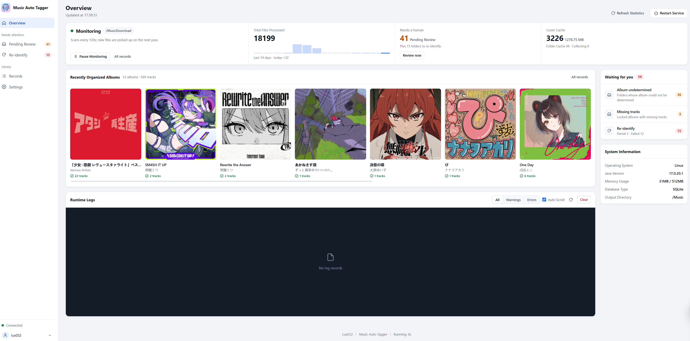

# 🎵 Music Auto Tagger | Automated Music Library Organizer

<div align="center">


[](https://www.java.com/)
[](https://www.docker.com/)
[](https://musicbrainz.org/)
[](https://lrclib.net/)
[](LICENSE)
[](https://github.com/lux032/MusicAutoTagger/releases)

[English](README.md) | [简体中文](README_ZH.md)

</div>

**Music Auto Tagger** is an automated music library organizer based on **audio fingerprinting** and **duration sequence fingerprinting**. Designed for NAS and server environments, it monitors your download folder, identifies music files, fetches comprehensive metadata (including lyrics), and organizes them into a clean structure.

> **Core Value**: Say goodbye to messy music folders. Automatically tag, cover, and organize your music library to perfection.

## 📊 Web Monitoring Dashboard



The built-in real-time monitoring dashboard provides:
- 📊 Real-time statistics and processing progress
- 📝 Recently processed files with detailed metadata
- 📋 Live system logs with auto-scroll
- ⚙️ System configuration and status overview
- ✅ Pending review queue and manual re-identification pages, sharing one design system
- 🗂️ Processed records page: search/filter history, re-identify or forget single files or whole albums, export CSV

## 🆕 What's New in 1.4.0

- 🖥️ **Redesigned Web UI**: A shared design system across the dashboard, review, and recovery pages — two-column dashboard layout, cover-art wall for recent albums, unified dialogs/toasts, collapsible navigation on narrow screens, and a fully localized (CN/EN) interface.
- ✅ **Manual Review Queue** (`review.enabled`): When tracks are recognized but the album cannot be determined, the folder is queued instead of being archived by guesswork. Original files keep their tags, names, and locations until you confirm a release, archive it as “not in MusicBrainz”, or reject it.
- 🛠️ **Re-identification & Recovery**: A dedicated page for the `partial_files` / `failed_files` quarantine folders. Retry jobs run in an atomic workspace (rollback on failure, cross-filesystem safe), and a **recycle bin** with a retention policy keeps the quarantined copies restorable.
- 🌐 **Online-assisted Identification**: Optional web search to build album candidates for hard cases, with two backends — native model web search or **Tavily** (`llm.webSearch.provider`). Candidates require at least one HIGH or two independent MEDIUM sources, and they always end up in the review queue for human confirmation, never auto-archived.
- 🤖 **New LLM Configuration Model**: Providers are first-class (name / URL / key / explicit OpenAI or Claude protocol / multiple models), stored in `data/llm-providers.json`. **Pull models** from a provider to fill a dropdown and self-test connectivity in one click. Old comma-separated settings are migrated automatically on first start. Server-side SSRF guards only allow public HTTPS endpoints unless `llm.allowPrivateEndpoints` is enabled.
- 🧠 **LLM Album Judging**: Optional LLM arbitration for ambiguous album matches, with an auto-apply confidence threshold.
- 🎨 **Anime-edition Cover Preference** (`cover.preferAnimeEdition`): For Japanese OP/ED singles that ship both an anime jacket and a regular artist jacket, candidate releases are scored by keyword so the anime cover wins, with fallback to the default cover.
- 🏷️ **Release-type Tags for Plex**: Writes EP / Single / Album release types and MusicBrainz IDs so Plex and similar players can distinguish them properly.
- 🕘 **Historical Cover Backfill**: A maintenance tool (Settings → Advanced) that backfills `release_group_id` for already-processed records album-by-album and warms the cover cache. Resumable, never touches audio files, and only accepts exact title matches with score ≥ 80.
- ⚡ **Matching & Performance Fixes**: Cache priority reordered (manual > duration sequence > quick scan > voting), multi-disc track counting fixed, release-group–level margin comparison, cached tag scanning, and album-artist resolution from artist credits (no more single-artist albums landing in `Various Artists`).
- 🔒 **Security Hardening**: `audio.normalize.ffmpegPath` is read-only via the API (command-execution vector), secrets are returned masked from `GET /api/config`, write APIs validate CSRF, and filenames are sanitized for length, reserved device names, and traversal-unsafe components.

Upgrading from an earlier version? Read [UPGRADE_NOTES.md](UPGRADE_NOTES.md) first.

## ✨ Key Features

- 🎧 **Audio Fingerprinting**: Uses **Chromaprint (AcoustID)** to accurately identify files even with garbled filenames (e.g., `track01.mp3`).
- 📝 **Authoritative Metadata**: Sources data from **MusicBrainz** to automatically complete Title, Artist, Album, Year, **Composer**, **Lyricist**, and more.
- 📜 **Synced Lyrics**: 🆕 Integrates with **LrcLib** to automatically download and embed **synced lyrics (.lrc)**, perfect for modern players.
- 🖼️ **HD Cover Art**: Automatically downloads and embeds high-quality album art from the Cover Art Archive.
- 📁 **Automated Organization**: Automatically renames and sorts files into a `Artist/Album/Title` structure.
- 🤖 **Unattended Operation**: Works seamlessly with qBittorrent/Transmission to process downloads automatically upon completion.
- ⚡ **Smart Scan Optimization**: 🆕 **Two-tier identification + folder-level caching**
    - **Tier 1: Quick Scan** - Tag & duration sequence matching, passes at 90% accuracy
    - **Tier 2: Fingerprint** - Only triggered when quick scan fails, ensures high recognition rate
    - **Folder-level Caching** - Subsequent files in the same album use cached results, skip all scans
    - **Performance Boost**: Processing a 16-track album requires only 1 full scan + 15 cache lookups
- 💾 **Three Persistence Modes**:
    - **SQLite Mode (Default)**: Embedded single-file database (`data/music-tagger.db`). No database server needed, tables are created automatically on startup.
    - **MySQL Mode**: Supports external database connection for massive libraries and high concurrency.
    - **File Mode**: Uses a plain text log to track processed files (legacy). Existing logs are imported automatically when switching to SQLite.
- 🐳 **Docker Ready**: Provides lightweight Docker images compatible with Synology, QNAP, Unraid, and other NAS systems.
- 🔄 **Smart Retry**: Automatically handles network failures with retry logic and isolates failed files for later inspection.
- 📊 **Web Monitoring Dashboard**: 🆕 Built-in real-time monitoring dashboard to visualize processing progress, system status, and runtime logs.
- 🌐 **Multi-language Support**: 🆕 Supports both Chinese and English interfaces, easily switchable via configuration file, providing localized experience for global users.
- 🤖 **LLM Artist Matching**: Optional LLM-assisted matching for partial recognition scenarios. When files have tags and covers but fingerprint recognition fails, uses LLM to fuzzy match artist names (supports romanization, aliases, translations, etc.) and automatically archives to the correct artist folder. Supports multiple providers/models with automatic failover.
- ✅ **Human-in-the-loop**: 🆕 Ambiguous albums go to a review queue instead of being archived incorrectly; quarantined files can be retried, confirmed with online evidence, or restored from the recycle bin.

## ⚠️ Best Practice: How to Get the Most Accurate Results

Since music releases are extremely complex (Singles, EPs, Albums, Compilations, Deluxe Editions, etc.), to ensure the tool accurately categorizes your music into the correct albums, it is **highly recommended** to follow this practice:

> **Please place audio files from the same album (or single) into a separate folder** before processing them with this tool.

❌ **Not Recommended**: Dumping hundreds of songs from different artists and albums into a single directory.
✅ **Recommended**:
  - `/Downloads/Jay_Chou_Fantasy/` (Contains songs from the Fantasy album)
  - `/Downloads/Adele_21/` (Contains songs from the 21 album)

**Reason**: When files are isolated in separate folders, the program can better determine that they belong to the same album based on context, avoiding misidentification of album tracks as "Best Of" compilations or "Single" versions.
## Quick Start (Docker Compose)

The easiest way to run the application. Configuration is done in the web UI after login.

1.  **Create docker-compose.yml**
    ```yaml
    version: '3.8'
    services:
      music-tagger:
        image: ghcr.io/lux032/musicautotagger:latest
        container_name: music-tagger
        ports:
          - "8080:8080"  # Web dashboard
        environment:
          - PUID=1000
          - PGID=1000
          - UMASK=022
        volumes:
          - /path/to/downloads:/music
          - /path/to/music_library:/app/tagged_music
          # SQLite database, admin account, review queue, LLM providers, recovery trash (keep persisted!)
          - ./data:/app/data
          # quarantine dirs used by the recovery page (otherwise lost on recreate)
          - ./partial_files:/app/partial_files
          - ./failed_files:/app/failed_files
          - ./config.properties:/app/config.properties
        restart: unless-stopped
    ```

    Set `PUID`/`PGID` to match the NAS user/group that owns your mounted folders. `UMASK` controls default permissions.

    > 💡 The built-in SQLite database is used by default — **no separate MySQL container is needed**. Processing history lives in `./data/music-tagger.db`; as long as `./data` is kept, recreating the container loses nothing.

2.  **Start Service**
    ```bash
    docker-compose up -d
    ```

3.  **Access Web Monitoring Dashboard**

    Open `http://localhost:8080` in your browser.
    - First visit will prompt you to create an admin account (stored in `data/admin.json`).
    - If `config.properties` is missing, the app auto-generates it on startup.
    - All settings (API keys, database, proxy, paths, language) are managed in the web UI.

## 💻 Local Installation

If you prefer to run it locally for development or testing:

### Prerequisites
- JDK 17+
- Maven 3.6+
- [Chromaprint (fpcalc)](https://acoustid.org/chromaprint) (Must be added to system PATH)
- [FFmpeg](https://ffmpeg.org/) (Must be added to system PATH)

### Build & Run
```bash
# 1. Build
mvn clean package

# 2. Run
java -jar target/MusicDemo-1.4.0.jar

# 3. Access Web Dashboard
# Open http://localhost:8080 in your browser
```

Configuration is created automatically on first run.
All settings (API keys, database, proxy, paths, language) are managed in the web UI after login.
The SQLite database is created at `data/music-tagger.db` relative to the **current working directory**, so always start the app from the same directory.

## 💾 Data Storage

The app keeps track of which files have already been processed (to avoid re-processing) and caches cover art metadata. Three storage backends are available via `db.type` (also editable under Settings → Database; **takes effect after restart**):

| `db.type` | Description | Setup cost | Best for |
|-----------|-------------|------------|----------|
| `sqlite` (default) | Embedded single-file database, tables created automatically | None | Most personal / NAS users |
| `mysql` | External MySQL server | Install MySQL and run `schema.sql` | Existing MySQL setups, external querying |
| `file` | Plain text log (legacy default) | None | Backward compatibility only |

**SQLite settings** (usually no changes needed):
```properties
db.type=sqlite
# Relative to the working directory; /app/data/music-tagger.db in Docker
db.sqlite.path=data/music-tagger.db
```

**Upgrading from file mode**: if you never set `db.type` explicitly, you are switched to SQLite on upgrade. On first start, the old log at `logging.processedFileLogPath` is imported once, so already-processed files are not identified again; the original log file is left untouched. To stay on file mode, set `db.type=file`.

**Viewing and editing records**: everyday tasks (search, re-identify files, delete records, export) are handled on the **Records** page of the web dashboard, for all three storage modes. "Re-identify" immediately re-queues files that are still in the monitored folder and never deletes or moves audio files. For lower-level edits, stop the app and open `data/music-tagger.db` with DB Browser for SQLite or `sqlite3`.

**Backup**: stop the app and copy the whole `data/` directory. The `music-tagger.db-wal` / `-shm` files that appear while running are normal and should be copied too.

**Caveat**: do not put the SQLite file on an SMB / NFS network share (unreliable file locking can corrupt the database); use a local volume on your NAS. For MySQL details see [Database Setup](docs/DATABASE_SETUP.md).

## 📚 Documentation

- **QNAP NAS Users**: See [QNAP Deployment Guide](docs/QNAP_DEPLOYMENT_GUIDE.md) (Chinese)
- **Database Setup**: Default is SQLite (zero setup, just persist the `data/` directory). For MySQL setup, see [Database Setup](docs/DATABASE_SETUP.md)
- **Windows Guide**: [Windows Build & Test](docs/WINDOWS_BUILD_GUIDE.md)
- **Upgrade Notes**: [UPGRADE_NOTES.md](UPGRADE_NOTES.md) (behaviour changes and operational caveats)
- **Album Matching**: [ALBUM_MATCHING_FIXES.md](ALBUM_MATCHING_FIXES.md), [FOLDER_ALBUM_CACHE.md](FOLDER_ALBUM_CACHE.md)
- **All Settings**: see [config.properties.example](config.properties.example); every documented key is also editable in the web settings panel (except the read-only `audio.normalize.ffmpegPath`).

## 🤝 Contribution

Issues and Pull Requests are welcome!

If this project helps you, please consider giving it a ⭐ **Star**!

## 📄 License

This project is licensed under the [MIT License](LICENSE).

### License Summary

The MIT License is a permissive open source license that allows you to:
- ✅ Commercial use
- ✅ Modification
- ✅ Distribution
- ✅ Private use

**The only requirement** is to include the copyright notice and license notice in all copies or substantial portions of the software.

### Third-Party Services

This tool relies on the following third-party services. Please respect their respective Terms of Service:
- [MusicBrainz](https://musicbrainz.org/) - Music metadata service
- [AcoustID](https://acoustid.org/) - Audio fingerprinting service
- [LrcLib](https://lrclib.net/) - Lyrics service
- [Cover Art Archive](https://coverartarchive.org/) - Album art service
- [FFmpeg](https://ffmpeg.org/) - Audio processing toolkit

---
**Disclaimer**: This tool relies on third-party services (MusicBrainz, AcoustID, LrcLib). Please respect their Terms of Service.

### Missing lyrics maintenance

Settings → Maintenance tools → **Fill Missing Library Lyrics** offers Preview, Start and Stop. **Pause external music-library writers before an actual run** (tag editors, synchronizers, players that save tags). The application serializes its own library writes and Recovery replacements, but this is not a cross-process lock. Preview uses LRCLIB and shows counters without writing audio, sidecars or negative-cache entries. API: authenticated `GET /api/lyrics-backfill/status`; session/CSRF-protected `POST /api/lyrics-backfill/preview`, `/start`, `/cancel`. A second job receives HTTP 409.

The scan reads the output library directly, not processing history. At job start it snapshots the eight effective protected directories: monitor, recovery trash/work, cover cache, failed/partial output, CUE split output and review staging. These subtrees, hidden children/internal temporary files and symlinks are excluded; ordinary names such as `Cache Cache`, `Trash`, `cache song` or a `MusicCache` library root are not excluded. A hidden library root itself is allowed. Relative configured paths resolve against process CWD using the owning services’ whitespace/default rules (blank trash: `data/recovery-trash`, blank work: output `/.recovery-work`, blank staging: `data/review-staging`, null/empty cover cache: output `/.cover_cache`). Existing protected paths use real paths and provider/filesystem-scoped file identities for aliases; missing paths use normalized absolute paths. A library root inside/equal to any protected directory fails with `lyrics.backfill.root.conflict:<field>` before lookup; invalid/unknown protection fails closed. Case-insensitive/macOS/Windows behavior is not verified in this environment. Nonempty matching `.lrc`/`.txt` or any embedded lyrics are retained and skipped. Unknown tags, missing title/artist/reliable local duration, instrumental tracks and ambiguous/version-conflicting matches are skipped. WAV is excluded. OGG/Vorbis and Opus are skipped because unchanged audio content cannot currently be strictly verified. MP3, FLAC and MP4/M4A are attempted only when each file provides a verifiable audio range and all checks pass; this is not a blanket format guarantee. Synthetic MPEG frames parsed successfully but exposed no verifiable header audio range and were safely skipped. Real MP3/MP4 round trips have not been validated in this environment; passing write evidence currently comes from structural synthetic FLAC fixtures, not decoded playback. FLAC with leading ID3 is skipped without stripping.

The writer changes only lyrics on a same-directory hidden copy; audio bytes, duration, other tag fields and cover are checked before an atomic replacement (no non-atomic fallback). File identity/size/mtime/hash and absence of lyrics/sidecars are rechecked; mtime and POSIX permissions/owner/group are preserved. Failed verification leaves the original untouched. Unsupported filesystems/permissions are skipped. Hidden `.lyrics-work-*` remnants after a crash are excluded from scans. Optional sidecar export creates synced `.lrc` or plain `.txt` only when absent; music files are not moved or renamed.

A bounded 2,000-entry `.lyrics-negative-cache.json` persists strict identity, exact fractional duration and album-sensitive misses: no lyrics about 7 days; unsafe/ambiguous or instrumental about 1 day. Transient errors and cancellation are never cached; preview neither populates nor consumes the cache. Stop interrupts the worker and active request; network faults defer rather than block ingestion through a long cooldown.

Strict LRCLIB duplicate handling is shared by ingestion and backfill: the raw 20-result truncation bound and conflicting duplicate IDs remain unsafe. Exact same-ID records are deduplicated; different IDs are accepted only when their complete objects excluding ID agree, with lyric text compared only after newline/trailing-whitespace/outer-blank-line normalization. Album, numeric duration/type, raw title/artist, synchronized timelines and unknown fields must agree. The lowest positive integral long ID represents the group; its original text is used, never blended. Identity/version and ±2-second filtering remain mandatory; no fuzzy score or manual lyrics candidates. Negative-cache key version is now `lyrics-v3`; previous v2 misses do not suppress new lookups (including a one-time refresh of old NOT_FOUND entries). TTL and bounds are unchanged.
