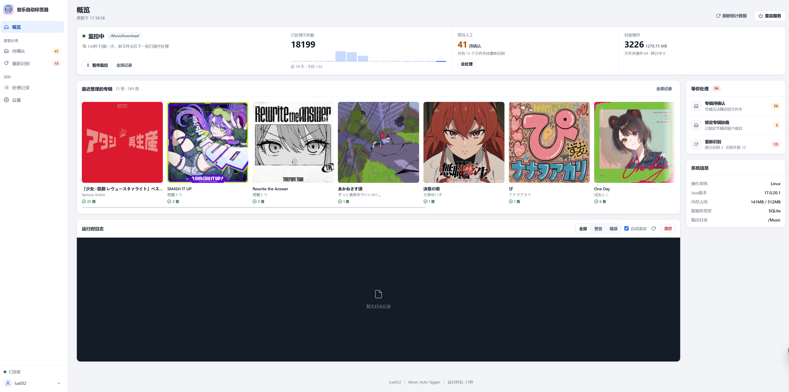

# 🎵 Music Auto Tagger | 音乐文件自动整理工具

<div align="center">


[](https://www.java.com/)
[](https://www.docker.com/)
[](https://musicbrainz.org/)
[](https://lrclib.net/)
[](LICENSE)
[](https://github.com/lux032/MusicAutoTagger/releases)

[简体中文](README_ZH.md) | [English](README.md)

</div>

**Music Auto Tagger** 是一个基于**音频指纹**和**时长序列指纹**的自动化音乐整理工具。它专为 NAS 和服务器环境设计，能够"监听"下载目录，自动识别音乐文件，补全元数据（包括歌词），并整理归档。

> **核心价值**: 告别杂乱无章的音乐文件夹，让你的音乐库自动拥有完美的标签、封面和歌词。

## 📊 Web 监控面板



内置实时监控面板提供：
- 📊 实时统计信息和处理进度
- 🧭 首次启动 5 步初始化引导（待命模式 + 免重启进程内激活）
- 📝 最近处理的文件及详细元数据
- 📋 实时系统日志，支持自动滚动
- ⚙️ 系统配置和状态概览
- ✅ 「待确认」「缺少封面」与「重新识别」页面，与仪表盘共用一套设计系统
- 🗂️ 「处理记录」页面：支持文件夹 / 文件双视图切换，搜索筛选历史记录，按单曲或整张专辑重新识别 / 删除记录，流式导出 CSV

## 🆕 1.6.0 新增内容

- 🧭 **首次启动初始化引导与待命模式**：全新部署启动后默认进入待命模式，在完成配置前不会提前扫描下载目录；Web 面板提供 5 步向导（账号与语言 → 目录与代理 → AcoustID / MusicBrainz → AI 与联网搜索（可选） → 整理偏好与启动确认），内置实时连通性自检，提交后在进程内直接激活服务，无需重启容器。
- 🌍 **MusicBrainz 发行地区优先级全链路生效与东亚艺人原生名归一**：`release.countryPriority` 统一覆盖全部 6 条选版与时长匹配路径（`曲目/时长匹配 > 地区优先级 > 介质格式 > 更早发行日`）。新增 `tag.artist.preferNativeName=true`（支持热更新），当 MusicBrainz 将东亚艺人署名写作纯罗马音（如 `Yuki Kajiura`）时自动归一为原生文字（`梶浦由記`），同时保留官方拉丁艺名（`YOASOBI`、`LiSA`、`Aimer`）、欧美艺人、连接词与 MBID 对齐。
- 🖼️ **缺少封面审核工作流**（`covers.html`）：缺封面专辑不再直接裸奔入库，而是转入独立的「缺少封面」队列（`cover.missing.requireReview=true`，独立于 `review.enabled`），支持后台 iTunes + AI 联网搜图、手动上传、原图灯箱预览、统一封面压缩与按需扫描存量音乐库补图。
- ✅ **待确认页三段式重构、结构化原因诊断与 AI 本地归档**：待确认页升级为「建议 → 选择核对 → 决策」三段式交互，内置逐曲时长对照、结构化原因卡片（`ReviewDiagnosis`）、队列搜索/按原因筛选与直达链接，并新增针对 MusicBrainz 未收录专辑的 AI 辅助本地标签归档。
- 🎼 **联网归档幕后人员提取/编辑与结构化多艺人标签**：联网识别支持提取曲目级作曲/作词/编曲并按 `release.countryPriority` 本地化命名，确认弹窗支持查看来源徽章并手动编辑/清空（优先级：`手动 > MusicBrainz > 本地 > 联网`）。FLAC/Vorbis、ID3v2.3/v2.4、MP4 全面写入结构化多值 `ARTISTS` / `ALBUM_ARTISTS` / `COMPOSERS` / `LYRICISTS` / `ARRANGERS` 及索引对齐的创作者 MBID；`tag.albumArtist.collapseToVariousArtists` 默认值改为 `false`，并配套提供存量 `Various Artists` 专辑批量刷新与归位维护工具。
- 🔎 **统一联网搜索队列与处理记录文件夹视图**：待确认、缺少封面与恢复页共用统一后台联网搜索队列（`llm.webSearch.maxConcurrency`，默认 `1`）及实时进度卡片；处理记录页新增可切换的文件夹视图与内联展开，改用 `folder_path` 索引 SQL 分页与流式 CSV 导出。
- 🔒 **安全、稳定性与运维部署全面加固**：完成 P0–P2 全量审计修复，涵盖出站 SSRF 防护与 DNS 固定（`OutboundUrlValidator`）、FFmpeg 安全调用、全局常量时间 CSRF 与登录限流、恢复工作区崩溃回滚、多碟/匹配/歌词回填修复、可配置 `web.port` / `WEB_PORT`、`gosu` 安全降权、`$BUILDPLATFORM` 多架构快速构建以及 CI 强制测试门禁（`mvn -B clean test`）。

从旧版本升级前，请先阅读 [UPGRADE_NOTES.md](UPGRADE_NOTES.md)。

## ✨ 核心特性

- 🎧 **音频指纹识别**：基于 **Chromaprint (AcoustID)**，即使文件名是乱码 (`track01.mp3`) 也能精准识别。
- 📝 **权威元数据**：数据源自 **MusicBrainz**，自动补全标题、艺术家、专辑、年份、**作曲**、**作词**等信息。
- 📜 **自动同步歌词**：🆕 集成 **LrcLib**，自动下载并嵌入 **同步歌词 (.lrc)**，完美支持现代播放器。
- 🖼️ **高清封面**：自动从 Cover Art Archive 下载并内嵌高清专辑封面。
- 📁 **自动化整理**：按照 `艺术家/专辑/歌曲名` 的结构自动重命名和归档文件。
- 🤖 **无人值守**：配合 qBittorrent/Transmission 使用，下载完成后自动处理，无需人工干预。
- ⚡ **智能扫描优化**：🆕 **两级识别策略 + 时长序列指纹 + 文件夹级缓存**
    - **第一级：快速扫描** - 基于标签和时长序列指纹匹配，90% 准确率即可通过
    - **第二级：指纹识别** - 仅在快速扫描失败时启用，保证识别率
    - **文件夹级缓存** - 同一专辑的后续文件直接使用缓存，跳过所有扫描
    - **性能提升**：处理一张 16 首的专辑，仅需 1 次完整扫描 + 15 次缓存查询
- 💾 **三种持久化模式**：
    - **SQLite 模式 (默认)**：嵌入式单文件数据库（`data/music-tagger.db`），无需安装数据库服务，启动时自动建表，开箱即用。
    - **MySQL 模式**：支持连接外部数据库，适合海量文件和高性能并发场景。
    - **文本模式**：使用纯文本日志记录已处理文件（旧模式）；切换到 SQLite 时历史记录会自动导入。
- 🐳 **Docker 部署**：提供轻量级 Docker 镜像，支持 Synology/QNAP/Unraid 等 NAS 系统。
- 🔄 **智能重试机制**：自动处理网络波动导致的识别失败，并提供失败文件隔离。
- 📊 **Web 监控面板**：🆕 内置实时监控面板，可视化查看处理进度、系统状态和运行日志。
- 🌐 **多语言支持**：🆕 支持中文和英文界面，可通过配置文件轻松切换语言，为全球用户提供本地化体验。
- 🤖 **LLM 艺术家匹配**：可选的 LLM 辅助匹配功能，用于部分识别场景。当文件有标签和封面但指纹识别失败时，使用 LLM 模糊匹配艺术家名称（支持罗马音、别名、翻译等），自动归档到正确的艺术家文件夹。支持配置多个供应商与模型实现自动故障转移。
- ✅ **人工介入闭环**：🆕 无法确定的专辑进入待确认队列而不是被错误归档；隔离文件可手动重试、借助联网证据确认，或从回收站还原。

## ⚠️ 最佳实践：如何获得最精准的整理效果

由于音乐发行形式极其复杂（包含单曲 Single、迷你专辑 EP、正规专辑 Album、精选集 Best、豪华版 Deluxe 等），为了确保工具能将您的音乐精确归类到正确的专辑中，**强烈建议**遵循以下操作：

> **请将同一张专辑（或单曲）的音频文件放入一个单独的文件夹中**，然后再交由本工具处理。

❌ **不推荐**：将成百上千首不同歌手、不同专辑的歌曲混合堆放在同一个目录下。
✅ **推荐**：
  - `/Downloads/Jay_Chou_Fantasy/` (包含范特西整张专辑的歌曲)
  - `/Downloads/Adele_21/` (包含 21 整张专辑的歌曲)

**原因**：当文件被隔离在独立文件夹时，程序能结合上下文更好地判断它们属于同一张专辑，从而避免将正规专辑中的歌曲误匹配到后续发行的“精选集”或“单曲”版本中。
## 🚀 快速开始 (Docker Compose)

这是最简单的运行方式。无需安装 Java 环境。
配置在登录后设置面板完成。

1.  **创建 `docker-compose.yml`**
    ```yaml
    version: '3.8'
    services:
      music-tagger:
        image: ghcr.io/lux032/musicautotagger:latest
        container_name: music-tagger
        ports:
          - "8080:8080"
        environment:
          - PUID=1000
          - PGID=1000
          - UMASK=022
        volumes:
          - /path/to/downloads:/music
          - /path/to/music_library:/app/tagged_music
          # SQLite 数据库、管理员账号、待确认队列、LLM 供应商配置、回收站（务必持久化）
          - ./data:/app/data
          # 恢复页面操作的隔离目录（不挂载则容器重建即丢失）
          - ./partial_files:/app/partial_files
          - ./failed_files:/app/failed_files
          - ./config.properties:/app/config.properties
        restart: unless-stopped
    ```

    `PUID`/`PGID` 设置为 NAS 挂载目录所属用户/组的 UID/GID，`UMASK` 控制默认权限。

    > 💡 默认使用内置 SQLite 数据库，**无需再部署 MySQL 容器**。处理记录保存在 `./data/music-tagger.db`，只要保留 `./data` 目录，重建容器后记录不会丢失。

2.  **启动服务**
    ```bash
    docker-compose up -d
    ```

3.  **访问 Web 监控面板**

    启动后，在浏览器中访问 `http://localhost:8080` 即可查看实时监控面板。
    面板使用本地管理员账号，存放在 `data/admin.json`。
    首次访问会进入 5 步初始化引导（创建管理员账号、语言、目录、代理、AcoustID / MusicBrainz、可选 AI 与联网搜索），期间处于待命模式不会提前扫描下载目录，完成后在进程内直接启动服务。
    如果 `config.properties` 不存在，程序启动时会自动生成默认配置。

    面板功能包括：
    - 📊 **实时统计**：已处理文件数、封面缓存、文件夹缓存等
    - 📝 **最近整理的专辑**：按专辑聚合展示最近成功归档的封面墙
    - 📋 **运行日志**：实时查看系统运行日志，支持自动滚动
    - ⚙️ **设置与系统信息**：在面板内完成全部配置（API Key / 数据库 / 代理 / LLM 供应商 / 联网搜索 / 恢复等）
    - ✅ **待确认 / 缺少封面 / 重新识别**：人工确认专辑、补全缺失封面、重试隔离文件、管理回收站
    - 🗂️ **处理记录**：支持文件夹 / 文件双视图，搜索 / 筛选已处理文件，单条或整张专辑批量「重新识别」或删除记录，流式导出 CSV

## 💻 本地运行

如果你想在本地开发或运行：

### 前置要求
- JDK 17+
- Maven 3.6+
- [Chromaprint (fpcalc)](https://acoustid.org/chromaprint) (需添加到系统 PATH)
- [FFmpeg](https://ffmpeg.org/) (需添加到系统 PATH)

### 编译与运行
```bash
# 1. 编译
mvn clean package

# 2. 运行
java -jar target/MusicDemo-1.6.0.jar

# 3. 访问 Web 面板
# 浏览器打开 http://localhost:8080
```

配置会在首次启动时自动生成。
API Key/数据库/代理/路径/语言等在登录后设置面板中配置。
SQLite 数据库默认创建在**当前工作目录**下的 `data/music-tagger.db`，请在固定目录中启动程序。

## 💾 数据存储

程序需要记录「哪些文件已经处理过」以避免重复整理，并缓存封面信息。支持三种存储方式，通过 `db.type` 选择（也可在 设置 → 数据库 中修改，**重启后生效**）：

| `db.type` | 说明 | 部署成本 | 适用场景 |
|-----------|------|----------|----------|
| `sqlite`（默认） | 内置单文件数据库，启动时自动建表 | 无 | 绝大多数个人 / NAS 用户 |
| `mysql` | 连接外部 MySQL 服务 | 需安装 MySQL 并执行 `schema.sql` | 已有 MySQL、需要外部查询或集中管理 |
| `file` | 纯文本日志（旧版默认） | 无 | 仅为兼容保留 |

**SQLite 配置**（一般无需改动）：
```properties
db.type=sqlite
# 相对路径基于工作目录；Docker 中即 /app/data/music-tagger.db
db.sqlite.path=data/music-tagger.db
```

**从旧版本（文本模式）升级**：如果你之前没有显式设置 `db.type`，升级后会自动切换为 SQLite。首次启动时，程序会把 `logging.processedFileLogPath` 指向的旧日志一次性导入数据库，已处理的文件不会被重新识别；原日志文件保留不动。若想继续使用文本模式，设置 `db.type=file` 即可。

**查看与修改记录**：常见操作（搜索、让文件重新识别、删除记录、导出）直接在 Web 面板的「处理记录」页面完成，三种存储模式均适用；「重新识别」会立即把仍在监控目录中的文件重新加入处理队列，不会删除或移动任何音频文件。需要更底层的修改时，可在停止程序后用 DB Browser for SQLite / `sqlite3` 打开 `data/music-tagger.db`。

**备份**：停止程序后复制整个 `data/` 目录。运行中目录下出现 `music-tagger.db-wal` / `-shm` 文件属正常现象，备份时需一并复制。

**注意**：不要把 SQLite 数据库文件放在 SMB / NFS 等网络共享上（文件锁不可靠，可能损坏数据库）；在 NAS 上请使用本地卷。MySQL 的详细配置参见 [数据库设置](docs/DATABASE_SETUP.md)。

## 📚 文档指南

- **QNAP NAS 用户**：请参阅 [QNAP 部署指南](docs/QNAP_DEPLOYMENT_GUIDE.md)
- **数据库配置**：默认使用 SQLite（零配置，只需持久化 `data/` 目录），如需使用 MySQL 请参阅 [数据库设置](docs/DATABASE_SETUP.md)
- **Windows 指南**：[Windows 构建与测试](docs/WINDOWS_BUILD_GUIDE.md)
- **升级注意事项**：[UPGRADE_NOTES.md](UPGRADE_NOTES.md)（行为变化与运维注意点）
- **专辑匹配机制**：[ALBUM_MATCHING_FIXES.md](ALBUM_MATCHING_FIXES.md)、[FOLDER_ALBUM_CACHE.md](FOLDER_ALBUM_CACHE.md)
- **全部配置项**：参见 [config.properties.example.zh](config.properties.example.zh)；除只读的 `audio.normalize.ffmpegPath` 外，均可在 Web 设置面板中修改。

## 贡献与支持

欢迎提交 Issue 或 Pull Request！

如果你觉得这个项目对你有帮助，请给个 ⭐ **Star** 支持一下！

## 📄 开源许可

本项目采用 [MIT License](LICENSE) 进行开源。

### 许可证说明

MIT 许可证是一个宽松的开源许可证，允许你：
- ✅ 商业使用
- ✅ 修改源代码
- ✅ 分发
- ✅ 私人使用

**唯一的要求**是：在软件的所有副本或重要部分中保留版权声明和许可声明。

### 第三方服务声明

本工具依赖以下第三方服务，请遵守它们各自的服务条款：
- [MusicBrainz](https://musicbrainz.org/) - 音乐元数据服务
- [AcoustID](https://acoustid.org/) - 音频指纹识别服务
- [LrcLib](https://lrclib.net/) - 歌词服务
- [Cover Art Archive](https://coverartarchive.org/) - 封面图片服务
- [FFmpeg](https://ffmpeg.org/) - 音频处理工具

---
**Disclaimer**: This tool relies on third-party services (MusicBrainz, AcoustID, LrcLib). Please respect their Terms of Service.

### 缺失歌词回填

设置 → 维护工具 → **补全音乐库缺失歌词** 提供预演、开始和停止。**正式运行前请暂停外部音乐库写入工具**（标签编辑器、同步程序、会保存标签的播放器）。应用内部音乐库写入与 Recovery 替换互斥，但不是跨进程锁。预演会联网检索，只展示计数，不修改音频、旁置文件或负缓存。API：鉴权 `GET /api/lyrics-backfill/status`；会话/CSRF 保护 `POST /api/lyrics-backfill/preview`、`/start`、`/cancel`；并发启动返回 409。

直接扫描输出音乐库，不依赖历史记录；任务开始时快照八类有效保护目录：监控、恢复回收站/工作区、封面缓存、失败/部分识别、CUE 分割输出、审核暂存；仅按有效路径排除这些子树，同时排除隐藏子项/内部临时文件及符号链接。普通名称 `Cache Cache`、`Trash`、`cache song` 或 `MusicCache` 根目录不会因名称被排除，隐藏音乐库根自身也可扫描。相对路径基于进程 CWD，沿用所属服务的空白/默认规则（空白回收站为 `data/recovery-trash`，工作区为 output 下 `.recovery-work`，暂存为 `data/review-staging`，null/空封面缓存为 output 下 `.cover_cache`）。已存在路径用 realPath 与限定 provider/文件系统的 fileKey 辅助识别别名，未存在路径按规范绝对路径。音乐库根等于或位于保护目录内时以 `lyrics.backfill.root.conflict:<字段>` 明确失败且不联网；配置未知/错误安全拒绝。macOS/Windows 大小写平台行为本环境未验证。已有内嵌歌词或同名非空 `.lrc`/`.txt` 始终保留并跳过。标签未知、缺少标题/艺人/可靠本地时长、伴奏、歧义或版本冲突均跳过。首版排除 WAV；OGG/Vorbis 与 Opus 因目前无法严格验证音频内容未变而跳过。MP3、FLAC、MP4/M4A 仅在逐文件音频范围和全部验证通过时尝试，不代表整个格式无条件支持。合成 MPEG 帧可读但音频头未提供可靠字节范围，已安全跳过；本环境未验证真实 MP3/MP4 往返。写入通过证据目前来自结构合成 FLAC 样本，不代表已验证音频播放解码。FLAC 带前置 ID3 直接跳过，不剥离。

专用写入器只在同目录隐藏副本设置歌词，验证音频字节、时长、其它标签和封面不变后原子替换，不降级普通覆盖；再次检查文件身份/大小/mtime/hash、歌词与旁置是否仍缺失。保留 mtime、POSIX 权限/属主/组，音乐文件不移动不改名。验证失败原件不变；不支持的文件系统/权限跳过。崩溃残留 `.lyrics-work-*` 隐藏副本可识别并排除。可选旁置导出：同步 `.lrc`、纯文本 `.txt`，仅不存在时创建。

最多 2000 条的 `.lyrics-negative-cache.json` 持久负缓存按严格身份、精确小数时长及专辑区分：无词约 7 天；不安全/歧义、纯音乐约 1 天。故障与取消不缓存；预演不读写缓存，不影响正式补齐。停止中断工作线程和当前请求，网络故障暂缓，不等待长冷却阻塞入库。

入库与回填共用严格 LRCLIB 去重：原始数组达到 20 条仍拒绝；同合法 ID 原始记录冲突仍拒绝，完全相同才去重。不同 ID 仅在去 ID 后的完整对象相等时视为等价；歌词比较只规范换行、行尾空白及首尾空行，不改大小写、标点或行内空白。专辑、时长及数值类型、原始标题艺人、同步时间轴和未知字段差异仍拒绝。选最小正整数 long ID 为代表，使用其原始文本，不混拼；身份/版本及 ±2 秒硬过滤不变，无模糊排序或人工歌词候选。负缓存键升级 `lyrics-v3`，旧 v2 不再抑制请求（旧 NOT_FOUND 会一次性重查），TTL 与容量不变。
